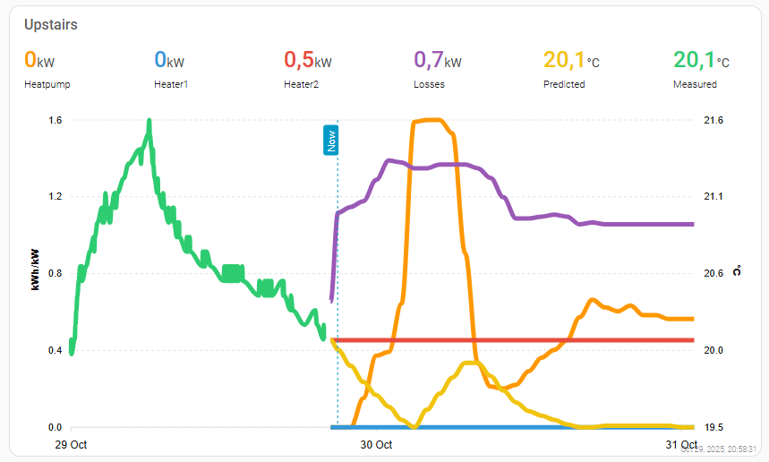

# Energy Optimizer
Home Assistant addon developed to be used as "heating cost optimizer". It is basically a RC model that is optimized with scipy minimize. Addon creates folder "energy-optimizer" in your Home Assistant config folder. You can model your house by editing /config/energy-optimizer/src/main.py . Check the comments to get an idea how to model your house with this code.

# Known bugs/"features"
1. Outdoor temperature has an offset of one "timestep" in the output. During simulation the timestamps should be correct.
2. Without penalties the model might optimize cents. Basically this might mean running the heater on full blast during a timestep to save one cent. This might work with resistive heating but is not that usable with heat pumps. So I advice to test the model thoroughly so that you get an idea how it works. Personally, I have added a penalty for sudden power level changes that seems to work well enough.
3. Be careful with temperature limits. Limits set during "Capacitance" creation are hard limits. Optimization fails if the start temperature is outside of these limits.

# Installation

[](https://my.home-assistant.io/redirect/supervisor_add_addon_repository/?repository_url=https%3A%2F%2Fgithub.com%2FT3m3z%2Fenergy-optimizer)

1. Install the addon (use the link above)
2. Set latitude/longitude on the addon configuration
3. Run the addon. This will run the optimization for an "example model" and create folders/files to your HA config folder.
4. Check the Addon logs. It should output the simulation results.
5. Modify /config/energy-optimizer/src/main.py to match your use case.
6. Add following to your configuration.yaml. This allows sensors to persist over reboots:
```yaml
homeassistant: # Find this row and if it doesn't exists, you can copypaste this whole block to the file.
  packages: # NEW AND IMPORTANT ROW, NOTE INDENTATION
    energyoptimizer: !include energy-optimizer/sensors/sensors.yaml # NEW AND IMPORTANT ROW, NOTE INDENTATION
  # There might be code here. Leave it as is.
```
7. Setup an automation to start the addon on desired interval.
8. Add automations that read data from sensors that this addon creates. See next chapter for examples.

# Jinja templates to extract data from sensors
This extracts the simulated temp for a "room" for the next available timestep. COuld be used to alter heater setpoints?
```

{{ (state_attr('sensor.energy_opt_house', 'data') | selectattr(0, "ge", time) | first)[1] }}
```
State attribute "data" contains list of lists containing: timestamp, simulated temperature, simulated heat losses in kWh.

This extracts the simulated next 0-1 (0-100%) control command for a heater for the next available timestep. Could be used to modify heater power with pwm for example.
```

{{ (state_attr('sensor.energy_opt_heatpump', 'data') | selectattr(0, "ge", time) | first)[1] }}
```
State attribute "data" contains list of lists containing: timestamp, simulated control 0-1, simulated heating in kWh.

# Visualization

See example file example-apexchart-code.yaml.

Output could be something like this:



# Support

I cannot guarantee any support right now for this addon. I just wanted to share it as I think that it might be useful to others too.

# Disclaimer

This package is a hobby project. I cannot guarantee that is works every time correctly and works in every situation as expected. There are most probably some bugs. You use this package at your own risk. Test what happens to your automation if your network connection is down and new prices aren't updated accordingly.